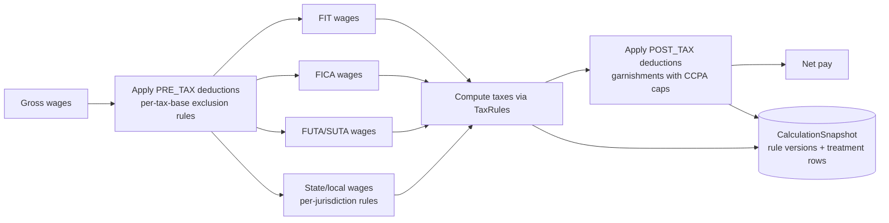
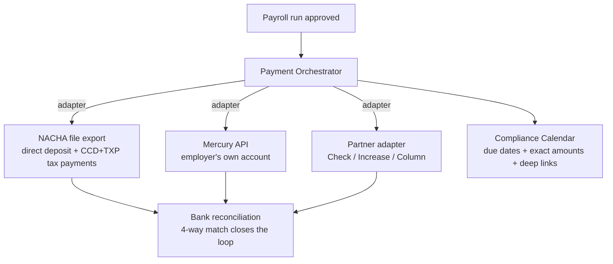

# Claude Analysis — Competitive Teardown, Gap Analysis & Roadmap

> **Source:** Multi-Agent Competitive Teardown Session (Step 28)
> **Date:** November 21, 2026

---

claude analysis # TaxShield Ledger: Competitive Teardown, Gap Analysis & Roadmap

Competitor prices and 2026 statutory limits below are from my working knowledge. Re-verify them before they go into marketing copy or a TaxPack. Nothing here is legal advice, and the money-transmission questions in particular need fintech counsel.

## Executive Summary

1. **Don't fight Gusto on autopilot. Win where autopilot matters least.** The strongest first segment is the **owner-only or 1–3 person S-Corp**: one or a few W-2s, a single state, low payroll complexity, and a CPA who dislikes black-box payroll journals. Money movement is a small problem for them, and bookkeeping plus reasonable-compensation compliance is a big one.
2. **The real moat is the evidence chain, not the price.** Patriot already sells at $17–$37. Your moat is the combination of `TaxRule` provenance, immutable `CalculationSnapshot`s, and the Schedule C/§274(d)/audit-score ledger that sits next to payroll. No incumbent offers that.
3. **Three premises in the brief need adjusting:**
   - Moov and Modern Treasury are **money-movement** vendors and don't file taxes. Check, Zeal and Gusto Embedded are **payroll-as-a-service** vendors. They solve different problems.
   - You can likely give OSS users most of the "full-service" feeling without custody. The **federal ACH-credit path to EFTPS** uses the same CCD+TXP mechanism you already built for PA.
   - **Section 125 is unavailable to >2% S-Corp shareholders.** That is a product feature, not just a footnote (see Dimension 2).
4. **Recommendation:** Wave 1 builds the deduction engine, SUTA settings and a NACHA direct-deposit file generator. Wave 2 builds 941/940 worksheets, EFW2 and the CPA bundle. Wave 3 uses a **partner model** (Check-class provider) for the commercial tier rather than becoming a reporting agent, with TaxShield positioned as the independent audit layer.

---

## Dimension 1: Market Positioning & Competitive Moat

### Competitor snapshot

| | Gusto | QBO Payroll | Patriot | Rippling | ERPNext |
|---|---|---|---|---|---|
| Price band | ~$40 + $6/worker | $45–$125 | $17–$37 | Quote-based, higher | Free (self-host) |
| Tax autopay/filing | Yes | Yes (tiers) | Full-service tier only | Yes | No, weak US payroll |
| Calculation transparency | Low | Low | Low | Low | Medium (but US tax content is thin) |
| Integrated Sched C/§274(d) ledger | No (needs QBO/Xero) | Yes, but not audit-grade | Separate accounting add-on | No | General-purpose |
| Self-host / zero lock-in | No | No | No | No | Yes |
| Typical weakness | Per-add-on pricing creep | Tier upsells | Dated UX | Overkill for micro | US compliance burden on you |

### Where the moat is real, and where it isn't

| Candidate moat | Verdict |
|---|---|
| Calculation transparency + immutable snapshots | **Real, but only valuable to a CPA or a worried owner.** Sell it as "show your work to the IRS/state in one click." |
| Payroll + Schedule C/S-Corp bookkeeping + accountable plan in one system | **Strongest.** Incumbents split these across products. |
| Audit Readiness Score | **Distinctive.** It's marketable and easy to explain. |
| Signed TaxPacks as an open standard | **Potentially the long-term moat.** A community-reviewed, cited rule corpus gets better with contributors, and incumbents can't copy the open model. |
| Self-hosting / privacy | Real for a niche. Not a mass-market driver. |
| Price | **Not a moat.** Patriot undercuts you. Only the SaaS tier faces this. |

### Why micro-LLCs leave Gusto/QBO, and what makes them switch

**Push factors:** price creep (per-contractor fees, state add-ons, tiered plans), loss of control over *why* a number is what it is, painful off-boarding of historical data, notices from agencies that the provider fixes slowly, and a CPA who re-keys payroll journals.

**What would pull them to you:**
- An S-Corp owner who wants **reasonable-compensation evidence** and clean distributions-versus-wages records.
- A CPA-endorsed **year-end bundle** (W-2/W-3, 941/940 worksheets, journal entries, receipts) that needs no cleanup.
- A "**Verify your provider**" mode: import a Gusto/QBO payroll register and show variance against your deterministic engine. This is a low-friction wedge because it requires no switching.

**The honest risk:** "Autopilot" (auto-remit and auto-file) is why people choose Gusto. If a user can't hit "run payroll" and walk away, many will stay put. Position as **"payroll you can prove"** rather than "payroll that's free."

---

## Dimension 2: Functional Gap Analysis

### 2.1 Pre-tax and post-tax deductions

**Principle:** keep the no-hardcode rule intact. The *treatment matrix* (what each deduction category excludes from each tax base) is TaxPack data, not an `if` statement.



**Illustrative treatment matrix** (seed this from sources into the TaxPack; state cells especially must be ingested, never assumed):

| Category | FIT | FICA | FUTA | Notes |
|---|---|---|---|---|
| §125 health/dental/vision (employee) | Excluded | Excluded | Excluded | Not available to >2% S-Corp shareholders |
| HSA via cafeteria plan | Excluded | Excluded | Excluded | Some states (e.g., NJ) don't conform; PA generally does |
| HSA direct (no §125) | Taxable at source | Taxable | Taxable | Employee deducts on the 1040 |
| Health FSA / Dependent-care FSA | Excluded | Excluded | Excluded | Annual limits by IRS notice |
| Traditional 401(k) | Excluded | **Taxable** | **Taxable** | PA/NJ and others tax deferrals at state level |
| Roth 401(k) | Taxable | Taxable | Taxable | Post-tax |
| Garnishments, union dues | n/a | n/a | n/a | Post-tax, CCPA limits and state priority rules |

**Design requirements:**
- Treatment rows keyed by `(category, jurisdiction, taxKind, effectiveDate)` with `excluded: boolean` plus citation.
- **YTD limit tracking** (§402(g), HSA, FSA, §415) with limits sourced from TaxPack, plus catch-up eligibility from DOB.
- **W-2 box mapping** (Box 12 codes D/W/AA/DD, Box 14 state-specific, Box 1/3/5 deltas), derived from the same category.
- **Employer match engine** (formula tiers, true-up) and ACP/top-heavy flags for later.
- **S-Corp owner special case:** a >2% shareholder's health premiums are included in Box 1 wages but are not subject to FICA/FUTA if paid under an accident-and-health plan. They are then deductible on the owner's 1040 as the self-employed health insurance deduction. Competitors handle this poorly, and getting it right is a differentiator.

### 2.2 SUI/SUTA with company-specific experience rates

The rule to hold onto is that the **statute** (wage base, rate range, new-employer default, schedule logic) lives in the TaxPack, while the **taxpayer-specific fact** (this company's assigned rate) is data the employer supplies.

- **TaxPack:** wage base per state/year, minimum and maximum permitted rate, new-employer default, any surcharge/add-on rules, FUTA credit-reduction states.
- **`CompanyTaxSetting`:** effective-dated, per-jurisdiction, with an uploaded agency rate notice (document hash plus issue date). Entry is validated against the pack's `[min, max]` bounds.
- **Resolver order:** active company rate (with notice) → new-employer default flagged "unverified" → hard warning at payroll run.
- **Snapshot** records both the pack rule version and the company setting row ID.
- **Roadmap hook:** a "rate notice due" calendar item each year, since most states issue rate notices around year-end.
- Don't forget **employee-paid** contributions (e.g., PA employee UC withholding) and **SDI/PFL/FLI** states (NJ, NY, etc.), which have the same shape.

### 2.3 Direct deposit without building a bank

You don't have to be a bank or a money transmitter if **the employer originates the ACH from the employer's own account**. Tiered options:

| Tier | Mechanism | Friction | Legal posture |
|---|---|---|---|
| A. NACHA file export | Employer uploads PPD file to their own bank's ACH origination portal | Medium (needs bank ACH origination approval) | You only generate a file. Employer is originator. |
| B. Mercury/bank API | Live API from the employer's own account | Low | Same, with an API instead of a file |
| C. ODFI-as-a-service | Increase, Column, Moov or similar, with the **employer** as originator | Low–medium | Vendor is the regulated entity. Counsel must confirm your role stays "software." |
| D. Payroll partner | Check/Zeal pay employees from the provider's rails | Lowest | Provider carries money-movement risk |

**Recommendation:** ship **A** in Wave 1, **B** as an adapter, and **D** for the commercial tier (Dimension 3). Reasons: A works for any US bank, costs nothing and carries no regulatory burden for you. Also note NACHA's expanding fraud-monitoring rules for originators; the employer's bank may ask questions.

### 2.4 Electronic agency reporting

**SSA EFW2 (annual W-2 batch):**
- Fixed-width, **512-byte** ASCII records.
- Record sequence: `RA` (submitter) → `RE` (employer) → `RW` (employee wage; plus `RO`, `RS` state as needed) → `RT` (employer totals) → optional `RU`, state totals `RV` → `RF` (final).
- Submitted via SSA **Business Services Online** (the W-2 Online form route is for small manual entry only). You can pre-validate with SSA's free testing tools.
- The SSA revises the spec yearly, so version the layout like any other `TaxRule` (a "format pack").
- Filing is **mandatory electronically at 10 or more** information returns in aggregate. Due **Jan 31**. W-2c uses a separate EFW2C format.

**Form 941:**
- Quarterly, due the last day of the month after quarter-end. Key lines include wages, FIT withheld, SS/Medicare at 12.4%/2.9%, Additional Medicare at 0.9% over $200k, and deposit reconciliation.
- **Schedule B** is needed for semiweekly depositors. Deposit schedule depends on the **lookback period** (the $50,000 test), and there is a **next-day** $100k rule.
- Small employers may be on **Form 944** annually if the IRS notifies them.

**Form 940:**
- Annual FUTA, due Jan 31. Needs **Schedule A** for credit-reduction states and multi-state credit.

**E-filing reality check:** direct IRS e-file of 941/940 runs through **Modernized e-File (MeF)**. That requires registering as an authorized provider/software developer and passing assurance (ATS) testing. It's a months-long process, not a 10-week feature. **Practical path:** produce the filled worksheet/PDF and reconciliation data, and let the employer or CPA file through the IRS portal or a partner. Treat direct MeF e-file as Wave 3 or partner territory.

**Gaps you didn't list but should track:**
- PA **local EIT** quarterly returns go to the local tax collector by residence/work location (PSD codes), not to the DOR.
- **New-hire reporting** (20-day state registry requirement).
- **Workers' comp** premium tie-in (mandatory in PA).
- State **W-2/withholding reconciliations** per state.
- **Supplemental wage** withholding and Pub 15-T percentage method handling (confirm both are pack rules).
- **Garnishment** support.

---

## Dimension 3: Make vs. Partner

### OSS: "near-full-service" without being a transmitter

**Principle: never touch the money; make doing it yourself nearly effortless.**



- **Federal deposits via ACH credit.** EFTPS supports enrolled employers originating an ACH credit with TXP addenda (tax type, period, amount), so your CCD+TXP generator can cover the IRS the same way it covers PA. Verify exact TXP field codes against the IRS/EFTPS ACH credit guide.
- **Deep links and pre-filled amounts** for EFTPS and state portals, with calendar reminders and a "mark paid" step that is later proven by bank reconciliation. Reconciled proof of remittance is the OSS answer to autopay.
- **Adapter interface** (`PaymentRailAdapter`) so users can plug in their own rail.

### Commercial tier: become a reporting agent, or partner?

| | Build (licensed reporting agent) | Partner (Check / Zeal / similar) |
|---|---|---|
| Upfront cost | High: bank sponsor, E&O/fidelity insurance, SOC 2, legal, state registrations, IRS reporting-agent process (Form 8655 authorizations) | Low: API integration |
| Time to market | 12–24 months | 2–4 months |
| Margin | Best at scale | Per-employee revenue share/fees to the partner |
| Risk | Funds-flow, NSF returns, fraud, penalties liability, state-by-state licensing | Partner concentration, outage dependency |
| Control of calculations | Full | **Partial: the provider often runs its own calc engine**, which conflicts with your deterministic-rule core |
| Dev ergonomics | You build everything | Good APIs, but you adapt to their data model |

**Recommendation: partner, with TaxShield as the independent verification layer.**
- Use the partner for money movement, deposits and filing.
- Run your own engine in parallel and **flag variance against the partner's numbers**. This preserves the audit-grade moat while avoiding licensing.
- Re-evaluate building only if volume justifies it (think thousands of paying companies) and treat licensing as a funded project, not a feature.

---

## Dimension 4: Schema Recommendations

### Benefits and deductions

```prisma
enum DeductionTiming { PRE_TAX POST_TAX }

enum BenefitCategory {
  SEC125_HEALTH SEC125_DENTAL SEC125_VISION
  HSA_CAFETERIA HSA_DIRECT HEALTH_FSA DEPENDENT_CARE_FSA
  K401_TRADITIONAL K401_ROTH
  S_CORP_2PCT_HEALTH
  GARNISHMENT UNION_DUES OTHER_POST_TAX
}

model BenefitPlan {
  id            String          @id @default(cuid())
  companyId     String
  name          String
  category      BenefitCategory
  timing        DeductionTiming
  carrier       String?
  // Resolves to TaxRule rows keyed by category + jurisdiction + taxKind
  treatmentKey  String
  employerMode  String          @default("NONE") // NONE | FLAT | PCT | MATCH
  matchFormula  Json?           // tiers, cap, true-up
  active        Boolean         @default(true)
  deductions    EmployeeDeduction[]
}

model EmployeeDeduction {
  id            String   @id @default(cuid())
  employeeId    String
  planId        String
  plan          BenefitPlan @relation(fields: [planId], references: [id])
  calcMethod    String   // FLAT | PCT_GROSS | PCT_ELIGIBLE
  amountCents   Int?
  percentBps    Int?
  perPeriodCap  Int?
  annualLimitRuleKey String? // limit comes from TaxPack
  effectiveFrom DateTime
  effectiveTo   DateTime?
  source        String   // election form id / court order id
}

model PayrollDeductionLine {
  id                  String @id @default(cuid())
  payrollItemId       String
  employeeDeductionId String
  employeeAmountCents Int
  employerAmountCents Int    @default(0)
  treatmentRuleRefs   Json   // exact TaxRule versions applied per tax base
}
```

### SUTA experience rates

```prisma
model CompanyTaxSetting {
  id              String   @id @default(cuid())
  companyId       String
  jurisdiction    String   // e.g. "PA", "NJ"
  taxKind         String   // SUI | SUI_ADDL | SDI | FLI ...
  rateBps         Int
  origin          String   // AGENCY_NOTICE | NEW_EMPLOYER_DEFAULT
  noticeDocId     String?  // uploaded rate notice
  noticeIssuedOn  DateTime?
  effectiveFrom   DateTime
  effectiveTo     DateTime?
  supersededById  String?
  employerAcctNo  String?  // encrypted at rest
  enteredBy       String
  createdAt       DateTime @default(now())
  @@index([companyId, jurisdiction, taxKind, effectiveFrom])
}
```

`ExperienceRateHistory` can simply be the effective-dated chain of `CompanyTaxSetting` rows via `supersededById`, which avoids a second source of truth.

### NACHA direct deposit

```prisma
model AchOriginatorProfile {
  id            String @id @default(cuid())
  companyId     String
  companyIdNo   String // 10-char ACH company identifier
  odfiRouting   String // 9 digits
  settlementAcctEnc String // encrypted
  fileIdModifier String @default("A")
  mode          String // FILE_EXPORT | API
}

model EmployeeBankAccount {
  id           String @id @default(cuid())
  employeeId   String
  routing      String
  acctEnc      String       // AES-256-GCM, same vault pattern as W-9
  acctType     String       // CHECKING | SAVINGS
  allocation   Json         // % / fixed / remainder
  prenoteStatus String      // PENDING | SENT | CLEARED
}

model AchBatch {
  id            String @id @default(cuid())
  payrollRunId  String
  effectiveDate DateTime
  totalCents    Int
  fileHash      String  // SHA-256 of generated file
  entries       AchEntry[]
}

model AchEntry {
  id           String @id @default(cuid())
  batchId      String
  batch        AchBatch @relation(fields: [batchId], references: [id])
  employeeBankAccountId String
  txnCode      String   // 22 chk credit, 32 sav credit, 23/33 prenote
  amountCents  Int
  traceNumber  String
}
```

**Generator essentials (PPD credits, 94-character fixed-width):**

| Rec | Content |
|---|---|
| 1 File header | priority 01, destination/origin routing, date/time, record size 094, blocking factor 10, format code 1 |
| 5 Batch header | service class 220 (credits only), company name, company ID, SEC `PPD`, entry description `PAYROLL`, effective date, ODFI |
| 6 Entry detail | txn code, RDFI routing + check digit, account (17), amount in cents (10), individual name (22), trace number |
| 8 Batch control | entry count, **entry hash** (sum of RDFI routing 8-digit fields, last 10 digits), total credits |
| 9 File control | batch count, block count, totals, then **pad with `9`-filled lines to a multiple of 10 records** |

```ts
const pad = (s: string, n: number) => s.slice(0, n).padEnd(n, " ");
const num = (v: number | string, n: number) => String(v).padStart(n, "0").slice(-n);
// validate every line is exactly 94 chars before writing; fail closed.
```

Notes:
- Some ODFIs require an **offsetting debit** entry (mixed service class 200) and others debit separately, so make this a bank-profile setting.
- Validate routing numbers by checksum, support **prenotes**, and cut-off/same-day windows differ by bank.

---

## Dimension 5: Prioritized Roadmap

### Wave 1 (Weeks 1–4): make the ledger irresistible

1. **Deduction engine** (§125, HSA, FSA, 401(k) trad/Roth, post-tax), with treatment matrix in TaxPack, YTD limits, and W-2 box mapping.
2. **S-Corp owner module:** >2% shareholder health handling, reasonable-compensation worksheet, distributions-vs-wages tracker.
3. **`CompanyTaxSetting`** for SUTA, with notice upload and bounds validation.
4. **NACHA PPD generator** plus employee bank account vault, and the **federal ACH credit TXP** generator for EFTPS.
5. **Verify-your-provider import** (Gusto/QBO payroll register CSV) with variance report.
6. Pay stubs and a payroll journal export for QBO/Xero/CSV.

### Wave 2 (Weeks 5–10): compliance and accountant enablement

1. **941 and 940 worksheets + PDFs** (incl. Schedule B, lookback-period depositor logic, Schedule A).
2. **EFW2 generator + validator** (RA/RE/RW/RT/RF first, optional records after). Scope this as the larger item, since it's tight for 10 weeks alongside the rest.
3. **State reconciliations and local EIT quarterly returns** for supported states.
4. **CPA export bundle:** journals, receipts, audit score, snapshot evidence, W-2/W-3.
5. New-hire reporting helper and deadline automation.

### Wave 3: commercial and scale

1. **Partner adapter** (Check-class) for deposits, remittance and filing, with TaxShield running the shadow calculation and variance alerts.
2. SaaS monetization: per-company base fee plus a per-worker fee, with the OSS version staying fully capable (open-core discipline).
3. Multi-state expansion driven by TaxPack contributions and a state-coverage dashboard.
4. Decide on **direct MeF e-file** (authorized-provider route) based on demand.
5. Revisit build-vs-partner at scale.

---

## Key Risks & Mitigations

| Risk | Mitigation |
|---|---|
| Penalty liability from calculation errors | Regression harness, snapshots, clear disclaimers, E&O insurance for SaaS |
| Money-transmitter exposure | Never hold funds in OSS; use partner rails or employer-originated ACH; get counsel sign-off |
| Rule-corpus maintenance burden | Contributor workflow, source diff alerts, signed releases |
| Overpromising "autopilot" | Market "payroll you can prove" and be explicit about who executes payments |

If useful, I can go deeper on any single piece, such as the full EFW2 record layouts, the TaxPack schema for the treatment matrix, or the Check-vs-Zeal evaluation criteria.
</USER_REQUEST>
<ADDITIONAL_METADATA>
The current local time is: 2026-11-21T18:53:08-05:00.
</ADDITIONAL_METADATA>